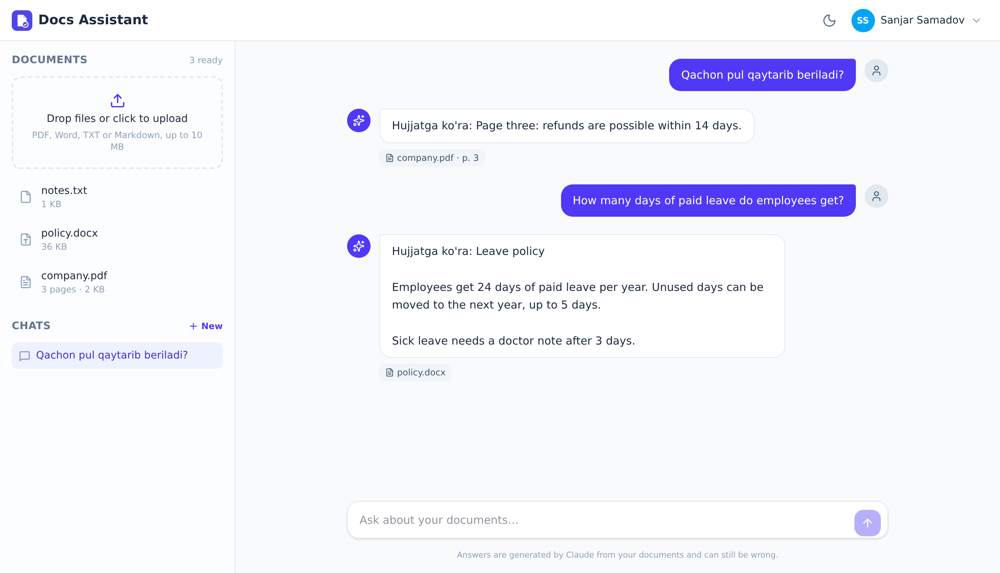

# docs-assistant

[](https://github.com/sanjar2709/docs-assistant/actions/workflows/ci.yml)

Upload your PDFs, Word files or notes and ask questions about them. Answers come only from your documents,
stream in as they are written, and every claim links to the file and page it came from.

It works across languages: a question in Uzbek finds the answer in an English or Russian document.



*Screenshot from a local run where the Claude API was replaced by a test stand-in, so the answers are just the quoted passages.*

## How it works

```
upload ──▶ worker: extract text ─▶ cut into chunks ─▶ embeddings ─▶ PostgreSQL + pgvector
                                                                         │
question ─▶ embed the question ─▶ nearest chunks (cosine) ───────────────┘
                                         │
                                         ▼
                    Claude, with the chunks as documents and citations on
                                         │
                                         ▼
                    answer streamed over SSE, citations mapped back to file + page
```

**Reading files.** PDFs are read page by page, Word and text files as one piece. Text is cut on paragraph,
then sentence boundaries into overlapping chunks of about 1200 characters, and a chunk never spans two PDF pages,
so a citation can always name the page. Scanned PDFs without a text layer fail with a clear message.

**Embeddings run locally.** `intfloat/multilingual-e5-large` through fastembed (ONNX, CPU, no API key).
I started with a smaller multilingual model, but it missed Uzbek questions: on a small test set of six questions
it got 4 right, e5-large got 6. The model downloads once (~2.2 GB) and stays in a Docker volume.

**Processing happens in the background.** The upload request only saves the file and puts a job in Redis;
an [arq](https://arq-docs.helpmanual.io/) worker extracts text and computes embeddings. The UI polls until the
document is ready.

**Answers use Claude's citations.** The retrieved chunks are sent as `document` blocks, one per file, one content
block per chunk, with citations enabled. Claude returns `content_block_location` citations that point at a document
and a block, which maps straight back to a chunk, its file and its page. No asking the model to "add sources in brackets".
If nothing relevant is found, the model still gets the question without documents and says the answer isn't there,
in the language the question was asked in. Requests use server-side fallbacks, so a declined request is retried on
another model within the same call.

## Running it

```bash
cp .env.example .env    # SECRET_KEY, database credentials, ANTHROPIC_API_KEY
docker compose up -d
```

Open http://localhost:3001. API docs: http://localhost:8003/api/docs. The first upload waits until the worker has
downloaded the embedding model.

For development, with the database and Redis in Docker:

```bash
docker compose up -d db redis

cd backend
python -m venv venv && source venv/bin/activate
pip install -r requirements/dev.txt
alembic upgrade head
uvicorn main:app --reload --port 8003
arq worker.WorkerSettings        # in another terminal

cd ../frontend
npm install
npm run dev
```

Without `REDIS_URL` documents are processed inside the upload request, handy for quick runs.

## API

| Method | Endpoint | |
|---|---|---|
| POST | `/api/v1/auth/register`, `/login`, `/refresh` | JWT auth |
| POST, GET | `/api/v1/documents` | upload (multipart), list |
| GET, DELETE | `/api/v1/documents/{id}` | status, delete with the stored file |
| GET | `/api/v1/documents/search?q=` | semantic search over your chunks |
| POST, GET | `/api/v1/conversations` | chats |
| POST | `/api/v1/conversations/{id}/messages` | ask; the answer is a `text/event-stream` |

The answer stream:

```
event: citation
data: {"document_title": "company.pdf", "page": 3, "cited_text": "Refunds are possible within 14 days.", ...}

event: text
data: {"text": "Pul 14 kun "}

event: text
data: {"text": "ichida qaytariladi."}

event: done
data: {"message_id": 12, "conversation_id": 3}
```

## Tests

```bash
cd backend && pytest --cov
```

46 tests, 97% coverage. They use a bag-of-words fake embedder (so CI doesn't download the model) and never call
the real API. The Claude part is tested at two levels: the request and the citation mapping with a stand-in client,
and the whole path through the official SDK against a fake HTTP server that answers in the API's streaming format
(`message_start`, `citations_delta`, `text_delta`, ...). CI also runs `alembic check`, and lint, type check and build
for the frontend.

## Project layout

```
backend/
  apps/
    documents/   upload, text extraction, chunking, search, reprocess command
    chat/        conversations, the answer stream
    users/       auth
  core/          settings, database, embeddings, Claude client, security
  worker.py      arq background worker
frontend/app/
  components/    Documents panel, Chat (messages, composer, sources), UI
  stores/        auth, documents, chat
  utils/         reading the SSE answer stream
```

## License

MIT
